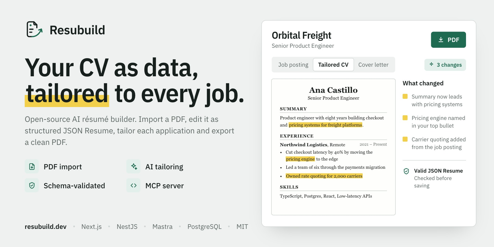

# Resubuild

[](https://github.com/yortyrh/resubuild)
[](./LICENSE)

<p align="center">
  <a href="https://app.resubuild.dev"></a>
</p>

<p align="center">
  <a href="https://app.resubuild.dev">app.resubuild.dev</a> · <a href="#local-development-docker">Run it locally</a> · <a href="https://github.com/yortyrh/resubuild">GitHub</a>
</p>



## What it does

- **AI PDF import** — upload any existing CV as a PDF, and Resubuild extracts the structured resume data for you.
- **Clean MIT-format editor** — tweak every section in a focused, keyboard-friendly editor. No formatting fight, no broken layouts.
- **One-click PDF export** — what you see in the preview is what you get in the downloaded PDF. No watermarks, no surprises.
- **Your CVs, your account** — sign in, and your CVs are saved under your account, private to you.
- **[See all features with video walkthroughs](/features)** — short recordings of every major feature.

The public marketing entry is **`/`** — a landing page that demonstrates the PDF-to-clean-CV transform before the auth wall. Deep-links to `/login`, `/register`, `/forgot-password`, etc. continue to work exactly as before.

<video controls autoplay muted loop playsinline style="max-width:100%;border-radius:0.75rem;" src="apps/web/public/recordings/showcase.mp4">
  <a href="/features">See all features</a>
</video>

---

## For developers

Monorepo for managing CVs with **Next.js** (UI), **NestJS** (REST API, authentication, schema validation) and **plain Postgres + S3-compatible storage + SMTP**. No hosted backend is required: any Postgres (Railway, DigitalOcean, AWS RDS, self-hosted), any S3 API (AWS S3, DigitalOcean Spaces, Railway Buckets, MinIO, RustFS…) and any SMTP server work.

The browser talks **only** to the API over HTTP with a Bearer token. Database, storage, mail and auth secrets stay server-side; [`apps/web/src/lib/web-bundle-security.test.ts`](apps/web/src/lib/web-bundle-security.test.ts) fails CI if web code imports server-only packages or references those secrets.

### Stack

- **apps/web** — Next.js App Router, shadcn-style UI; session token in `localStorage`; calls the API at `NEXT_PUBLIC_API_URL`
- **apps/api** — NestJS REST API: Better Auth at `/api/auth/*`, AJV validation against the [JSON Resume schema](https://raw.githubusercontent.com/jsonresume/resume-schema/refs/heads/master/schema.json), Drizzle data access, S3 storage, SMTP mail, MCP server
- **apps/import-agent** — Mastra PDF import workflow and reusable verification tools
- **packages/db** — Drizzle schema, SQL migrations (`packages/db/migrations`), Postgres client, PGlite test helper
- **packages/email-templates** — React Email templates for every transactional email
- **packages/schemas** — official resume JSON schema
- **packages/types** — shared TypeScript resume types
- **packages/resume-template** — MIT-format HTML renderer for preview and PDF export
- **packages/import-models** — pinned Mastra provider/model catalog for PDF import settings

## Authentication

Authentication runs inside the API with [Better Auth](https://www.better-auth.com): users, OAuth accounts, sessions and verification tokens live in the same Postgres (`user`, `account`, `session`, `verification`). Product requirements for every flow live in [`docs/requirements/auth.md`](docs/requirements/auth.md).

- Clients send `Authorization: Bearer <session token>`. Endpoints that create a session return the token in the `set-auth-token` response header.
- Sessions are stored server-side (7-day lifetime, extended on use). Logout and password changes revoke them.
- Data isolation is enforced in the API: every repository query is scoped by `user_id`. There is no row-level security to rely on.
- Email links (verification, reset, magic link) open web pages (`/auth/verify`, `/reset-password`, `/auth/magic`) that call the API with the token.
- OAuth runs on the API origin: `/auth/oauth/:provider` → provider → `/api/auth/callback/:provider` → `/auth/oauth/complete`. The API then redirects to the web `/auth/callback` with a single-use code that the SPA exchanges for its token (`POST /auth/oauth/exchange`). Web and API can live on different sites without third-party cookies.

### Auth flows

| Flow                              | Always on? | Flag (`apps/api/.env`; web mirror `NEXT_PUBLIC_*`)  | Requirement  |
| --------------------------------- | ---------- | --------------------------------------------------- | ------------ |
| Email + password login / register | yes        | —                                                   | REQ-AUTH-001 |
| Change password (authenticated)   | yes        | —                                                   | REQ-AUTH-004 |
| Forgot / reset password           | opt-in     | `AUTH_FORGOT_PASSWORD_ENABLED`                      | REQ-AUTH-005 |
| Email verification                | opt-in     | `AUTH_EMAIL_VERIFICATION_ENABLED`                   | REQ-AUTH-006 |
| Passwordless — magic link         | opt-in     | `AUTH_PASSWORDLESS_ENABLED`                         | REQ-AUTH-007 |
| Passwordless — 6-digit code       | opt-in     | `AUTH_PASSWORDLESS_ENABLED`                         | REQ-AUTH-007 |
| GitHub / Google / LinkedIn OAuth  | opt-in     | `<PROVIDER>_CLIENT_ID` + `<PROVIDER>_CLIENT_SECRET` | REQ-AUTH-008 |

### Feature flags

The API env (`apps/api/.env`) is the single source of truth: disabled flows are not registered with Better Auth, so their endpoints return 404. The SPA renders matching controls from build-time mirrors (`NEXT_PUBLIC_AUTH_FORGOT_PASSWORD_ENABLED`, `…_EMAIL_VERIFICATION_ENABLED`, `…_PASSWORDLESS_ENABLED`, `…_GITHUB_OAUTH_ENABLED`, `…_GOOGLE_OAUTH_ENABLED`, `…_LINKEDIN_OAUTH_ENABLED`) resolved by `apps/web/src/lib/auth/features.ts`. Only the literal string `true` enables a flag.

`pnpm setup:env` (local) and `pnpm setup:env:prod` (production) derive the web mirrors from the API values, so they cannot drift. An OAuth button turns on when both credentials of that provider are set. If you edit an env file by hand, re-run the generator or keep both files in sync. Flipping a flag in production requires a web rebuild.

### OAuth providers

Register this redirect URI with each provider: `<BETTER_AUTH_URL>/api/auth/callback/<github|google|linkedin>` (locally `http://localhost:3001/api/auth/callback/github`). Then set `GITHUB_CLIENT_ID` / `GITHUB_CLIENT_SECRET` (or the Google/LinkedIn pair) in `apps/api/.env` and re-run `pnpm setup:env`.

LinkedIn apps must have the **"Sign In with LinkedIn using OpenID Connect"** product enabled. Without it, LinkedIn rejects the `openid profile email` scopes with `invalid_scope_error`.

## Prerequisites

- pnpm 12+ (see `packageManager`). pnpm downloads the pinned Node.js (26 LTS, root `package.json` `devEngines.runtime`) on `pnpm install` and runs every script with it; any Node on PATH works for bootstrapping pnpm.
- Docker (or Podman) for the local infrastructure and the e2e tests.

## Local development (Docker)

[`docker-compose.dev.yml`](docker-compose.dev.yml) runs the backing services; the apps run on your machine with hot reload.

| Service  | Image                    | Host port(s)                       |
| -------- | ------------------------ | ---------------------------------- |
| Postgres | `postgres:18-alpine`     | 54432                              |
| Storage  | `rustfs/rustfs` (S3 API) | 54490 (S3), 54491 (console)        |
| Mailpit  | `axllent/mailpit`        | 54425 (SMTP), **54424 (inbox UI)** |

Ports can be changed with `RESUBUILD_POSTGRES_PORT`, `RESUBUILD_S3_PORT`, `RESUBUILD_S3_CONSOLE_PORT`, `RESUBUILD_SMTP_PORT` and `RESUBUILD_MAILPIT_PORT` (set them for both `pnpm infra:up` and `pnpm setup:env`). The storage image is S3-compatible; MinIO no longer publishes community images, but any S3 server can replace it without code changes.

### Setup

From the repo root:

```bash
pnpm install
pnpm infra:up       # start Postgres, storage and Mailpit; apply migrations; create buckets
pnpm setup:env      # write apps/api/.env and apps/web/.env (secrets generated once, then preserved)
pnpm samples:seed   # dev + E2E accounts, sample CVs and media (no API needed)
```

On first seed, **unique passwords are generated for your machine** and saved to `.samples/local-credentials.json` (gitignored). To show them again: `pnpm local:credentials`.

**Developer sign-in:** `developer@resubuild.local`, password from `pnpm local:credentials`.

Other infrastructure commands: `pnpm infra:down` (stop, keep data), `pnpm infra:reset` (stop and delete all local data), `pnpm infra:logs`, `pnpm db:migrate` (apply migrations), `pnpm db:generate` (create a migration after editing `packages/db/src/schema`).

### Run the app

```bash
pnpm dev            # web :3000 + api :3001
```

Open http://localhost:3000, sign in with the developer account, and you should see 10 sample CVs on the dashboard.

### Local email (Mailpit)

Every email the API sends locally is captured by **Mailpit**. Nothing reaches real inboxes.

**Inbox:** http://127.0.0.1:54424

In development the auth screens show a dashed **Development** banner with a direct Mailpit link. Production builds omit it.

| Flow                    | Where to trigger it                  | What to look for in Mailpit        |
| ----------------------- | ------------------------------------ | ---------------------------------- |
| Signup confirmation     | `/register`                          | Confirmation link → `/auth/verify` |
| Forgot password         | `/login` → **Forgot your password?** | Reset link → `/reset-password`     |
| Email code (OTP)        | `/login` → **Email code** tab        | 6-digit code                       |
| Email link (magic link) | `/login` → **Email link** tab        | Sign-in link → `/auth/magic`       |

To try these flows, set the matching `AUTH_*_ENABLED=true` in `apps/api/.env`, run `pnpm setup:env` to update the web mirrors, and restart `pnpm dev`.

Email templates live in [`packages/email-templates`](packages/email-templates) ([React Email](https://react.email)). Preview them with `pnpm --filter @resubuild/email-templates preview`.

### CV preview and PDF export

From any CV editor, use **Preview** to open `/dashboard/cv/[id]/preview` — a print-faithful MIT-format HTML view of the assembled resume (experience before education, ruled section headings). **Print** uses the browser; **Download PDF** calls `GET /cv/:id/export/pdf` on the API.

PDF generation uses headless Chromium (Puppeteer) in `apps/api`. For local dev, Puppeteer downloads its own browser. In production Docker, set `CHROMIUM_EXECUTABLE_PATH` to a system Chromium binary if the bundled browser is unavailable. HTML preview works without Chromium; PDF returns `503` when launch fails.

Regenerate sample PDFs from JSON fixtures: `pnpm samples:pdf` (builds `@resubuild/resume-template` first).

### PDF import smoke (optional)

Requires a real provider API key in AI agent settings. `pnpm setup:env` generates `AI_AGENT_ENCRYPTION_KEY`. Optional `TAVILY_API_KEY`, `FIRECRAWL_API_KEY` and `BRAVE_SEARCH_API_KEY` in `apps/api/.env` enable web search (profile discovery) and URL-import page extraction for all users; the API rotates between the configured providers round-robin and falls back to the next one when one fails or runs out of credit. PDF and DOCX files are converted locally with [`@firecrawl/anydoc`](https://github.com/firecrawl/anydoc); only scanned PDFs go to Firecrawl's hosted OCR (keyless, or with `FIRECRAWL_API_KEY` for higher limits).

1. Open `/dashboard/settings/import-llm`, pick provider → model → API key, and save.
2. Generate sample PDFs if needed: `pnpm samples:pdf`
3. On `/dashboard/cv/new`, use **Import PDF** with a file from `.samples/resumes/pdf/`.
4. Wait for the job to finish and confirm the editor shows extracted sections.

Manual checks:

- Invalid model id → settings save error, PDF import stays gated.
- Valid model + bad API key → `422`, PDF import stays disabled.
- Non-PDF or oversize upload → client/API error, no CV created.

### Tests

- **Unit** (`pnpm test`): Jest in the API, Vitest elsewhere. Repository specs run against [PGlite](https://pglite.dev) (Postgres compiled to WebAssembly, in memory), so they exercise real SQL without Docker.
- **E2E** (`pnpm test:e2e`): boots Nest in-process. [Testcontainers](https://testcontainers.com) starts a throw-away Postgres (data on tmpfs), S3 storage and Mailpit, then applies the migrations, seeds the fixture accounts and stops everything at the end. Only Docker is required: no `.env` file and no running dev stack. Email flows are asserted through the Mailpit API. With Podman, Testcontainers' Ryuk reaper is disabled automatically; global teardown stops the containers.

---

## Deploy

Production needs four things, all configured through env vars:

| Need     | Variables                                                                                                   | Examples                                                      |
| -------- | ----------------------------------------------------------------------------------------------------------- | ------------------------------------------------------------- |
| Postgres | `DATABASE_URL`                                                                                              | Railway Postgres, DigitalOcean Managed DB, AWS RDS            |
| Storage  | `S3_ENDPOINT`, `S3_REGION`, `S3_ACCESS_KEY_ID`, `S3_SECRET_ACCESS_KEY`, `MEDIA_BUCKET`, `MCP_EXPORT_BUCKET` | AWS S3, DigitalOcean Spaces, Railway Buckets, MinIO           |
| Email    | `SMTP_URL` (or `SMTP_HOST`/`SMTP_PORT`/`SMTP_USER`/`SMTP_PASSWORD`) or `RESEND_API_KEY`, `MAIL_FROM`        | Amazon SES, Postmark, Resend, Mailgun, Brevo (all speak SMTP) |
| Auth     | `BETTER_AUTH_SECRET`, `MCP_KEY_PEPPER`, optional OAuth client ids/secrets                                   | generated by `pnpm setup:env:prod`                            |

Buckets must be **private**: the API streams media itself and hands out short-lived presigned URLs for MCP exports. If the API reaches storage on an internal host, set `S3_PUBLIC_ENDPOINT` to the public one so presigned URLs work for clients.

Migrations run as a separate step before the API starts: `node packages/db/dist/migrate.js` (the API image includes it).

### Step 1 — Generate `.env.prod`

```bash
pnpm setup:env:prod
```

The script prompts for the values. It generates `BETTER_AUTH_SECRET`, `MCP_KEY_PEPPER` and `AI_AGENT_ENCRYPTION_KEY` when absent, and derives the web `NEXT_PUBLIC_AUTH_*` mirrors from the API flags.

**Non-interactive / agent flow:** write the values to a `prod-secrets.json` manifest (gitignored) and run `pnpm setup:env:prod --from prod-secrets.json`, so secret values never appear in a terminal transcript or chat. With `--from`, the three secrets must already be in the manifest, so a re-run never rotates them. Preview with `pnpm setup:env:prod:dry-run --from prod-secrets.json`.

### Docker compose

```bash
docker compose -f docker-compose.prod.yml --env-file .env.prod config   # verify
docker compose -f docker-compose.prod.yml --env-file .env.prod up -d
```

The one-shot `migrate` service applies migrations, then `api` and `web` start. Without TLS, a reverse proxy or a registry push, this is a minimal target.

To run Postgres and storage on the same host, add `--profile selfhost`. That starts `postgres` and `storage` (RustFS). Set `POSTGRES_PASSWORD`, point `DATABASE_URL` at `postgresql://resubuild:<password>@postgres:5432/resubuild` and `S3_ENDPOINT` at `http://storage:9000`, and set `S3_AUTO_CREATE_BUCKETS=true` so the API creates the buckets.

### Railway

The Railway target reuses `apps/api/Dockerfile` and `apps/web/Dockerfile`. Add a Railway **Postgres** (use its `DATABASE_URL`) and a **Bucket** (S3 credentials), and point SMTP at your mail provider. Railway blocks outbound SMTP on the Free, Trial and Hobby plans; there, set `RESEND_API_KEY` to send over the Resend HTTPS API instead. `apps/api/railway.json` runs the migrations as a pre-deploy command. Pass `--target railway` so the public-URL keys (`CORS_ORIGIN`, `APP_URL`, `PUBLIC_API_URL`, `NEXT_PUBLIC_API_URL`) default to the production custom domains (`https://app.resubuild.dev`, `https://api.resubuild.dev`):

```bash
pnpm setup:env:prod --target railway --from prod-secrets.json
```

| File                                                       | Purpose                                                  |
| ---------------------------------------------------------- | -------------------------------------------------------- |
| [`apps/api/railway.json`](apps/api/railway.json)           | api service config (build, pre-deploy migrations, start) |
| [`apps/web/railway.json`](apps/web/railway.json)           | web service config (build + start)                       |
| [`.railwayignore`](.railwayignore)                         | Build context exclusions                                 |
| [`scripts/deploy-railway.mjs`](scripts/deploy-railway.mjs) | Preflight wrapper (`pnpm deploy:railway`)                |

**Service topology and scale-to-zero.** Two services (`api`, `web`) share one Railway project. Each has `apps/{api,web}/railway.json` at its service root so Railway's monorepo auto-detect finds the build config next to its `Dockerfile`. Scale-to-zero ("App Sleeping") is a per-service dashboard setting (**Settings → App Sleeping**). It is not a `railway.json` field, so enable it by hand and redeploy. Attach the custom domains (`app.resubuild.dev`, `api.resubuild.dev`) to the matching services.

**Known limitations:** no persistent Puppeteer cache on the free tier (Chromium is re-downloaded on cold start); no per-PR preview environments; services talk over the public internet unless you use Railway's private network, so CORS must allow the public web origin.

```bash
curl -f https://api.resubuild.dev/_health
curl -f https://app.resubuild.dev/
```

### Migrating an existing Supabase deployment

[`scripts/migrate-from-supabase.mjs`](scripts/migrate-from-supabase.mjs) copies a Supabase project into the new setup. It keeps the same user ids, so every row keeps its owner.

1. Create the target schema: `DATABASE_URL=<target> pnpm db:migrate`.
2. Export the source and target settings (see the script header): `SOURCE_DATABASE_URL`, `SOURCE_S3_*` (Supabase Storage S3 keys from **Project Settings → Storage**), plus the target `DATABASE_URL` and `S3_*`. If the target bucket names differ from Supabase's `media` and `mcp-exports` (Railway Buckets get generated names), set `MEDIA_BUCKET` / `MCP_EXPORT_BUCKET` to the target names; both may point at the same bucket.
3. Rehearse: `pnpm migrate:from-supabase --dry-run`.
4. Migrate: `pnpm migrate:from-supabase`. It is idempotent and safe to re-run, and it prints per-table counts at the end.

**On Railway (no local access to the databases):** the API image ships the script as `apps/api/scripts/migrate-from-supabase.mjs`. Set the api service's pre-deploy command to `sh -c 'node packages/db/dist/migrate.js && node apps/api/scripts/migrate-from-supabase.mjs --if-configured'` and add the `SOURCE_*` variables to the service. Each deploy then creates the schema and copies whatever is missing. `--if-configured` makes the step a no-op once you remove `SOURCE_DATABASE_URL`. Rows already in the target are skipped, not updated, so for the final cutover start from an empty target database.

What moves: `auth.users` becomes `user`. Bcrypt password hashes keep working and are upgraded to scrypt on the next sign-in. GitHub, Google and LinkedIn identities become OAuth accounts. All application tables are copied, and so are the `media` and `mcp-exports` objects.

What does not move: active sessions, so everyone signs in again. If the old deployment ran without `MCP_KEY_PEPPER`, its MCP keys were hashed with `SUPABASE_SERVICE_ROLE_KEY`; set `MCP_KEY_PEPPER` to that old value to keep existing MCP keys valid.

## Quality checks

From the repo root:

- **`pnpm format`** / **`pnpm format:check`** — Prettier
- **`pnpm lint`** / **`pnpm lint:fix`** — Biome
- **`pnpm typecheck`** — TypeScript across all packages
- **`pnpm verify`** — full CI pipeline locally (Prettier, Biome, typecheck, unit tests, build)
- **`pnpm test`** — unit tests (Vitest + Jest)
- **`pnpm test:e2e`** — API integration tests in throw-away containers (needs Docker)
- **`pnpm local:credentials`** — show local dev and E2E login details for this machine

Git hooks (Lefthook): **pre-commit** (Biome + Prettier on staged files), **pre-push** (accepts only commits verified by `pnpm push`). Push with `pnpm push [git push args...]`: it runs `pnpm verify` before git connects to the remote, then pushes.

### Toolchain memory budget

The verify pipeline caps parallelism to keep peak memory under ~4 GB per process
on constrained environments (CI runners, laptops). Defaults:

| Tool                                     | Default cap                                          |
| ---------------------------------------- | ---------------------------------------------------- |
| Jest (`apps/api` unit tests)             | `--maxWorkers=2`                                     |
| Vitest (all workspaces)                  | `singleFork: true` (one fork)                        |
| Turborepo (`test`, `build`, `typecheck`) | `concurrency: 2`                                     |
| Prettier (`pnpm format`, `format:check`) | `--concurrency=2`                                    |
| Biome                                    | unchanged (~250 MB peak)                             |
| GitHub Actions CI                        | 3 parallel jobs (`quality`, `test-and-build`, `e2e`) |

To raise the cap on a larger machine, set the `RESUME_PARALLELISM` env var:

```bash
RESUME_PARALLELISM=8 pnpm verify   # 8 workers/forks for Jest, Vitest, Turborepo, Prettier
```

`RESUME_PARALLELISM` is not honored by Biome or GitHub Actions CI (those always
use the conservative defaults).

## Troubleshooting

| Error                                  | Fix                                                                                                                                                                |
| -------------------------------------- | ------------------------------------------------------------------------------------------------------------------------------------------------------------------ |
| `relation "cv" does not exist`         | Apply migrations: `pnpm infra:up` (local) or `pnpm db:migrate` with `DATABASE_URL`.                                                                                |
| `DATABASE_URL is not configured`       | Run `pnpm setup:env` (local) or set it in `.env.prod`.                                                                                                             |
| `Invalid or expired token`             | Sign out and sign in again; sessions are revoked on logout and password change.                                                                                    |
| No email arrives locally               | Open Mailpit at http://127.0.0.1:54424; check `SMTP_HOST`/`SMTP_PORT` in `apps/api/.env` and that `pnpm infra:up` is running.                                      |
| Port already in use on `pnpm infra:up` | Override with `RESUBUILD_*_PORT` (see [Local development](#local-development-docker)) and re-run `pnpm setup:env`.                                                 |
| Forgot local dev password              | Run `pnpm local:credentials`.                                                                                                                                      |
| `pnpm verify` fails on Node version    | Run it via pnpm (`pnpm verify`, not `node …`) after `pnpm install`; pnpm supplies Node 26 from `devEngines.runtime`. To upgrade Node: `pnpm runtime set node lts`. |

## Debugging the API

See [`apps/api/README.md`](apps/api/README.md#debugging-the-api) for the full guide covering `pnpm dev:api:debug`, the VS Code / Cursor launch configuration, `pnpm local:devtools`, and the `inspector-mcp` option for agent debugging.

## API (`apps/api`)

Sign in through Better Auth (`POST /api/auth/sign-in/email`, `POST /api/auth/sign-up/email`, …) and send the returned token as `Authorization: Bearer <token>`. The UI keeps it in `localStorage`.

| Method | Path                                       | Description                                                               |
| ------ | ------------------------------------------ | ------------------------------------------------------------------------- |
| \*     | `/api/auth/*`                              | Better Auth (sign-in/up, verify, reset, magic link, OTP, OAuth callbacks) |
| GET    | `/auth/me`                                 | Current user + `has_password`                                             |
| POST   | `/auth/password`                           | Change (or set a first) password; returns the new token                   |
| POST   | `/auth/logout`                             | Revoke the current session                                                |
| GET    | `/auth/oauth/:provider`                    | Start OAuth (top-level navigation)                                        |
| POST   | `/auth/oauth/exchange`                     | Exchange the OAuth one-time code for a token                              |
| GET    | `/cv`                                      | List user's CVs                                                           |
| GET    | `/cv/:id`                                  | Get one CV                                                                |
| POST   | `/cv`                                      | Create `{ title?, data }`                                                 |
| PATCH  | `/cv/:id`                                  | Update `{ title?, data? }`                                                |
| DELETE | `/cv/:id`                                  | Delete CV                                                                 |
| GET    | `/cv/:id/export/html`                      | Full MIT-format HTML document (auth)                                      |
| GET    | `/cv/:id/export/pdf`                       | PDF bytes (`Content-Disposition` attachment)                              |
| GET    | `/cv/:id/export/json`                      | JSON Resume download (`Content-Disposition` attachment)                   |
| GET    | `/import/llm/providers`                    | List PDF import LLM providers                                             |
| GET    | `/import/llm/providers/:providerId/models` | List models for a provider                                                |
| GET    | `/import/llm/config`                       | Current user's import LLM settings                                        |
| PUT    | `/import/llm/config`                       | Save provider/model/API key                                               |
| POST   | `/cv/import/pdf`                           | Start async PDF import (`202`, `{ jobId }`)                               |
| GET    | `/cv/import/:jobId`                        | Poll PDF import job status                                                |

## Security

- Every repository query is scoped by the authenticated user's id (no reliance on database row-level security); cross-user access is covered by unit and e2e tests.
- Sessions are stored and revoked server-side; passwords are hashed with scrypt (bcrypt hashes migrated from Supabase are upgraded on sign-in).
- Buckets are private; clients get media through the API and MCP exports through short-lived presigned URLs.
- The web bundle cannot import database, storage, mail or auth-server packages (`web-bundle-security.test.ts`).

## Project structure

```
apps/
  api/             NestJS REST API (auth, data, storage, mail, MCP)
  import-agent/    Mastra PDF import workflow
  web/             Next.js frontend
packages/
  db/              Drizzle schema + SQL migrations
  email-templates/ React Email templates
  import-models/   pinned Mastra provider/model catalog
  resume-template/ MIT HTML renderer for preview/PDF export
  schemas/         resume.schema.json
  types/           shared Resume types
docs/
  requirements/    product requirements (tech-agnostic, stable REQ ids)
docker-compose.dev.yml   local Postgres, S3 storage, Mailpit
docker-compose.prod.yml  production compose target
.samples/          seed fixture (CVs, media, local credentials)
```
